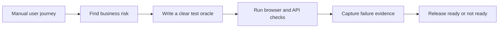
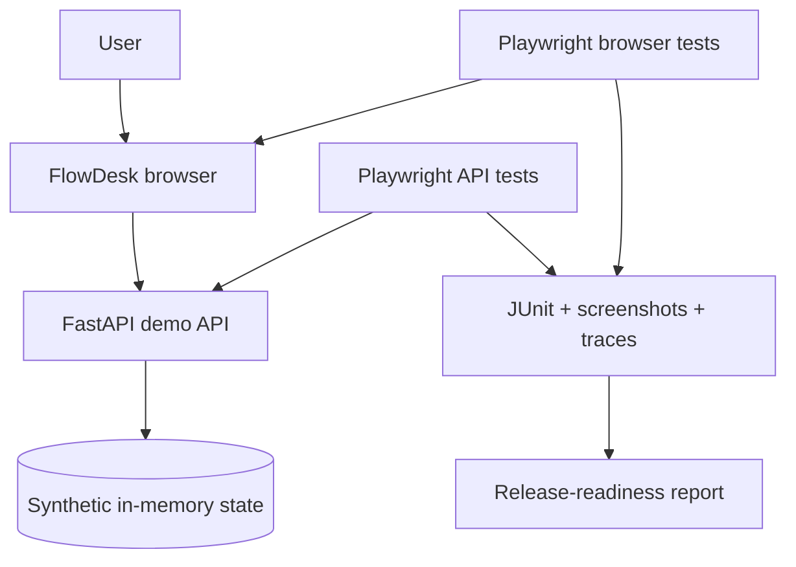

# QualiFi SaaS Release Guardrail

[](https://github.com/OperaAxe/qualifi-saas-release-guardrail/actions/workflows/ci.yml)

## The short version

This is a small fictional SaaS product called **FlowDesk**. I use it to show how I test a product before release.

The point is not the demo app. The point is the thinking:

> **What does a real user do, what could go wrong, and how do we know the fix stayed fixed?**

I start with the user journey manually. Then I turn the important checks into repeatable automated tests so the same risks are checked on every release.

## Start here: follow the user journey

You do not need to install anything to understand the project. The workflow has already run in GitHub Actions, and the repository contains the test plan and the demo application.

### 1. Log in as a real user would

Open the FlowDesk demo and log in as the synthetic owner account.

**What I am checking manually:**

- Does the login page make sense?
- Does a valid user reach the dashboard?
- Is a protected page still protected when the user is logged out?
- Does logout actually end the session?

### 2. Create something valuable

Create a project with a name and description.

**What I am checking manually:**

- Can the user complete the main action without confusion?
- Does the success state appear?
- Does the new project appear in the list?
- Does a refresh keep the project visible?

That last check matters. A green toast is not proof that data was saved.

### 3. Check the role boundary

Repeat the journey as a viewer account.

**What I am checking manually:**

- Can the viewer see what they are allowed to see?
- Is the restricted feature explained clearly?
- Can the viewer reach a forbidden action through a direct request, or is the server also enforcing the rule?

### 4. Check the subscription boundary

Compare a Pro account with a Free account.

**What I am checking manually:**

- Does the feature appear for the right plan?
- Does the restricted state explain what is unavailable?
- Does changing the UI hide a feature without accidentally removing the server-side protection?

### 5. Check the event edge case

Send the same subscription webhook twice.

**Expected result:** the first event is processed; the duplicate is handled safely instead of creating a second side effect.

## What gets automated after the manual pass



| Manual question | Automated proof | Why it matters |
|---|---|---|
| Can the user log in and log out? | Browser authentication test | Users cannot reach the product if access is broken. |
| Does a new project survive refresh? | End-to-end persistence test | A false success state creates support tickets and lost work. |
| Do roles see the right feature? | Role and entitlement tests | A wrong plan or role can create trust and revenue problems. |
| Is the API enforcing the rule? | Direct API permission check | Hiding a button is not access control. |
| Is a duplicate event safe? | Idempotency test | Billing and subscription events must not double-apply. |

## What a failed release looks like

The test suite does not turn a result into “90% green, ship anyway.” A required check fails, the release report becomes **`not_ready`**, and GitHub Actions keeps the screenshot, trace, JUnit result, and report as evidence.

That gives a team a useful conversation:

1. What user journey failed?
2. What did the user see?
3. What did the API return?
4. Is this a product defect, a test defect, or an environment problem?
5. Has the fix been checked again?

## Visual map of the project



## If you want to run it locally

The setup is intentionally below the walkthrough. This is a portfolio demo, so the shortest useful route is to inspect the Actions run first.

<details>
<summary>Local setup</summary>

### Windows PowerShell

```powershell
py -3.13 -m venv .venv
.\.venv\Scripts\Activate.ps1
python -m pip install --upgrade pip
python -m pip install -r requirements.txt
python -m playwright install chromium
pytest
```

### Bash

```bash
python3.13 -m venv .venv
source .venv/bin/activate
python -m pip install --upgrade pip
python -m pip install -r requirements.txt
python -m playwright install chromium
pytest
```

Run the demo app with `python -m uvicorn app.main:app --reload`, then open `http://127.0.0.1:8000`.

</details>

## Where to look

- `docs/critical-workflows.md` — the business-risk checklist
- `docs/demo-script.md` — the step-by-step walkthrough above
- `docs/test-strategy.md` — the test oracles and failure rules
- `tests/test_core_workflow.py` — the main user journey
- `tests/test_subscription_and_roles.py` — plan and role behavior
- `tools/generate_release_report.py` — turns real JUnit output into a release decision
- `.github/workflows/ci.yml` — runs the checks and uploads evidence

## Honest scope

FlowDesk is fictional. The data is synthetic. This is not a production application, payment integration, penetration test, or claim of complete coverage. It is a focused example of how I move from **manual QA → risk-based coverage → repeatable release evidence**.
